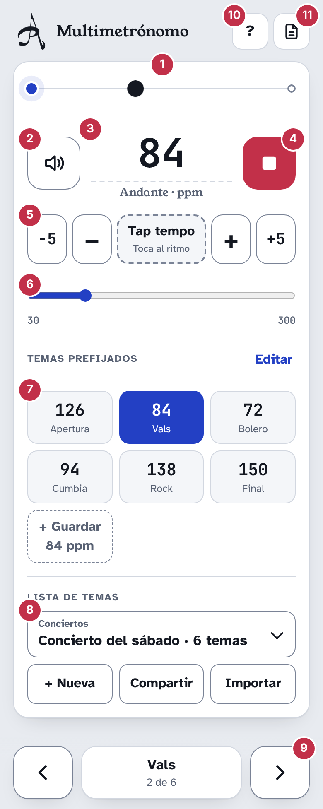
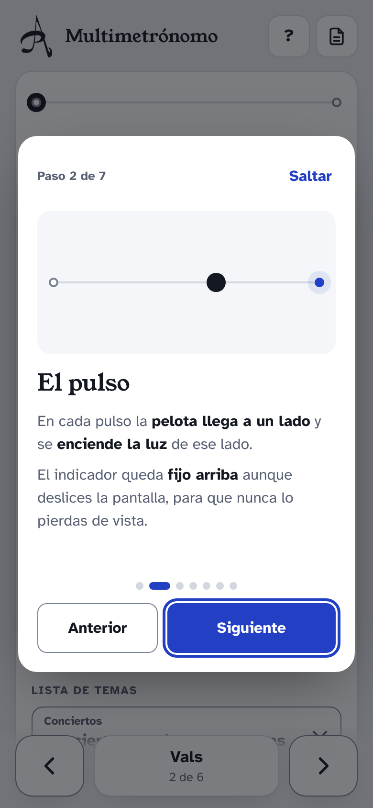
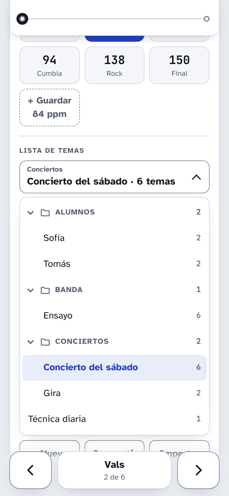
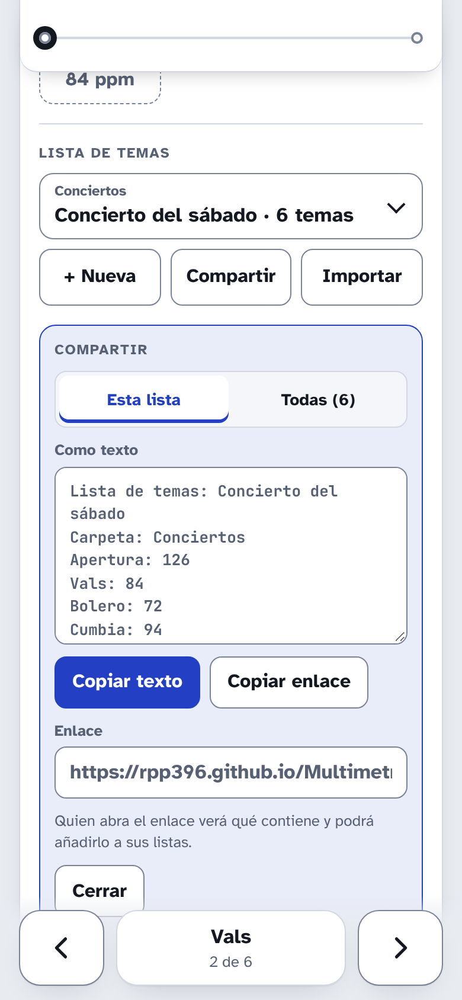
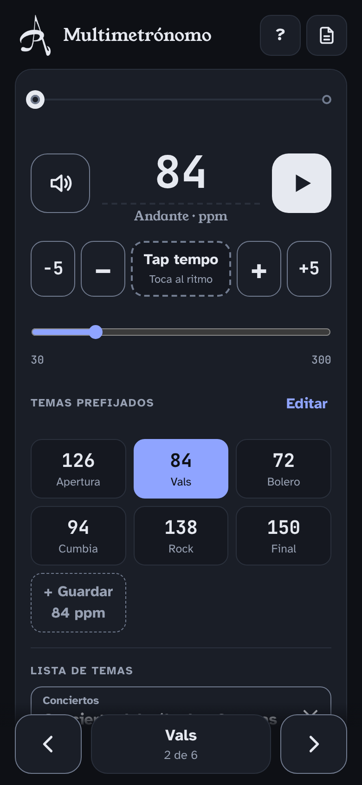

# Multimetrónomo

Metrónomo web pensado para el celular. Muestra el pulso con una pelota que va de un lado a otro y dos luces, tiene varias formas de elegir el tempo (incluido *tap tempo*) y guarda tus tempos con nombre en listas de temas organizadas en carpetas, que puedes compartir como texto o como enlace. Se instala como una app y funciona sin conexión.



## Qué incluye

- **Pulso visual:** en cada pulso la pelota llega a un extremo y se enciende la luz de ese lado. El indicador queda fijo arriba al desplazar la pantalla.
- **Sonido activable:** el altavoz quita o devuelve el clic sin parar el metrónomo.
- **Tempo de 30 a 300 ppm:** escribiendo el número, con − / + (de 1), −5 / +5, manteniéndolos pulsados, con **tap tempo** y con un deslizante que solo responde al arrastre horizontal (desplazar la página no cambia el tempo).
- **Temas prefijados con nombre:** guardar el tempo actual, elegirlo con un toque, editar nombre y tempo, reordenar y borrar. **‹ ›** (anterior y siguiente) van fijos abajo y siempre a la vista.
- **Listas de temas en carpetas:** un desplegable propio con carpetas que se abren y cierran; crear listas, cambiar su nombre y carpeta, borrarlas.
- **Compartir e importar:** como texto legible o como enlace (`#temas=`). Al importar se ve antes qué se añadirá; nunca se reemplaza nada.
- **Guía de bienvenida** la primera vez (se vuelve a ver con **?**) y **ayuda en PDF** ([`ayuda/Multimetronomo-ayuda.pdf`](ayuda/Multimetronomo-ayuda.pdf)).
- **App instalable y sin conexión** (manifiesto y service worker), modo oscuro automático, pantalla encendida mientras suena, y en iPhone suena aunque esté en silencio (iOS 17+).
- **Privada:** no hace ninguna petición a otros sitios (fuentes locales y CSP estricta); los datos quedan en el navegador.

| Guía de bienvenida | Listas en carpetas | Compartir | Modo oscuro |
|---|---|---|---|
|  |  |  |  |

## Uso

Abre `index.html` en el navegador o sirve la carpeta con cualquier servidor web (por ejemplo `python3 -m http.server`). No necesita instalación ni compilación. Para que funcione sin conexión y se pueda instalar, tiene que servirse por `https` (o `http://localhost`).

### Publicarla con GitHub Pages

En el repositorio: **Settings → Pages → Build and deployment → Source: Deploy from a branch**, elige la rama y la carpeta `/ (root)`, y guarda. En unos minutos queda en `https://<usuario>.github.io/Multimetronomo/`. Todas las rutas son relativas, así que funciona en esa subcarpeta.

Al publicar cambios, sube `VERSION` en `sw.js` para que los celulares que ya la tienen instalada descarguen la versión nueva.

## Formato de texto de las listas

```
Lista de temas: Concierto del sábado
Carpeta: Conciertos
Apertura: 126
Vals: 84
```

Cada línea con un número entre 30 y 300 es un tema (el último número es el tempo y el resto, el nombre); también valen `Vals 84`, `Vals - 84 bpm` o `84 Vals`. Las líneas que empiezan con `#` se ignoran. El enlace es la dirección de la app seguida de `#temas=` y este texto en base64url.

## Desarrollo

Sin dependencias ni build: `index.html`, `styles.css`, scripts clásicos en `js/` (en el orden en que los carga `index.html`), `fonts/` (tipografías locales con su licencia SIL OFL), `icons/`, `manifest.webmanifest` y `sw.js`. Ver [`CLAUDE.md`](CLAUDE.md) para el mapa del código y las convenciones.

### Pruebas

Necesitan Node.js 24 o posterior (la app en sí no usa Node: corre en el navegador).

```
npm install
npx playwright install chromium
npm test                 # todas las suites (tests/*.test.js)
node tests/run.js tempo  # solo las que coinciden
```

Se ejecutan también en GitHub Actions (`.github/workflows/tests.yml`).

### Capturas y ayuda en PDF

`npm run ayuda` (`node tools/ayuda.js`) rehace las capturas de `docs/capturas/` y la ayuda en PDF a partir de `ayuda/ayuda.html`. Conviene ejecutarlo cuando cambia la interfaz.

## Créditos

Basada en la estructura y el estilo de [DandEtudeDuR](https://github.com/rpp396/DandEtudeDuR). Tipografías: Young Serif, Atkinson Hyperlegible y JetBrains Mono (SIL Open Font License).
